## Activity

<picture>
  <source media="(prefers-color-scheme: dark)" srcset="git-info-combine/heatmap-dark.svg">
  
</picture>

API activity and local commits are different measures. Each square adds the daily units reported by the configured sources; colored segments show each source's share for that day. The legend names the sources actually included. Local commits use the configured time zone, while API calendars retain their own dates.

<picture>
  <source media="(prefers-color-scheme: dark)" srcset="git-info-combine/wakatime-dark.svg">
  
</picture>

[How this graph is updated](CONTRIBUTIONS.md)
