Ку, я программист из Санкт-Петербурга. Пишу всякие плагины, моды, сайтики, на спринге чета делаю. Как-то так

## Activity

<picture>
  <source media="(prefers-color-scheme: dark)" srcset="git-info-combine/layout-dark.svg">
  
</picture>
